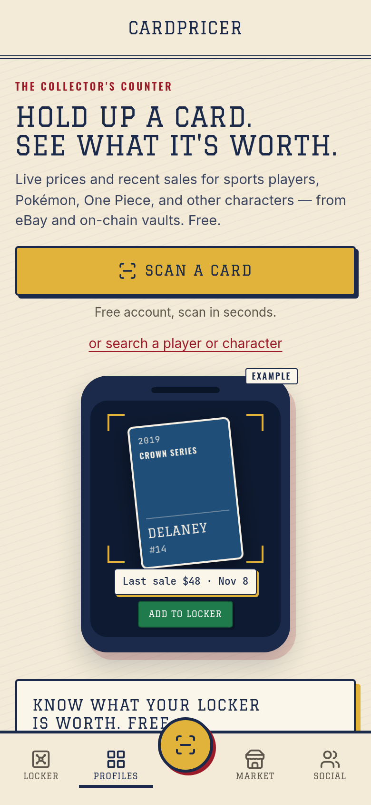
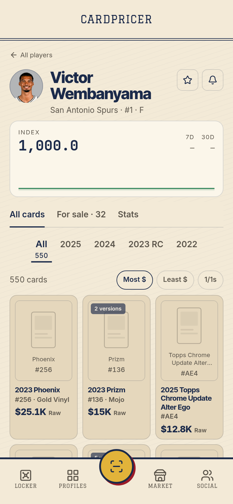
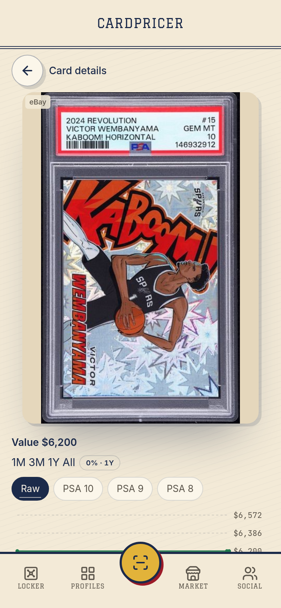
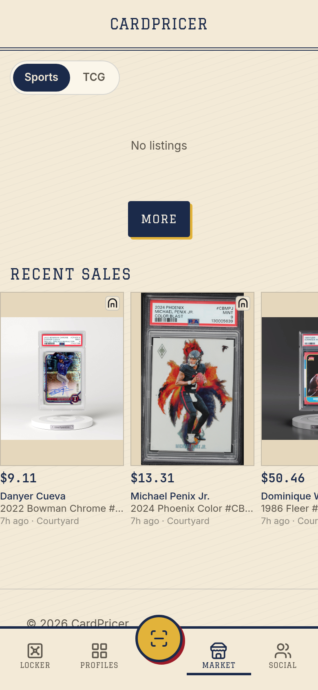

# CardPricer

CardPricer is a profile-first trading-card price app. It organizes cards around player and character profiles, and includes card scanning, portfolio tracking, and a marketplace. Public launch is December 1, 2026.

## Features

- Player and character profiles with recent sales and listings
- Individual card pages with price history
- Scan a single card or a binder page
- Portfolio tracking in a Locker, for cards in hand and tokenized vault cards
- Marketplace for cards currently for sale
- Prices from eBay sold listings and on-chain vault sales

## Tech stack

- Next.js
- TypeScript
- Supabase / Postgres
- Vercel
- Web3 vault data from Courtyard and Collector Crypt

## Site

[https://cardpricer.co](https://cardpricer.co)

## Screenshots

Phone screenshots of the live site, captured at 390×844.

### Home

### Player profile (Victor Wembanyama)

### Card page (2024 Revolution Kaboom Horizontal)

### Marketplace

